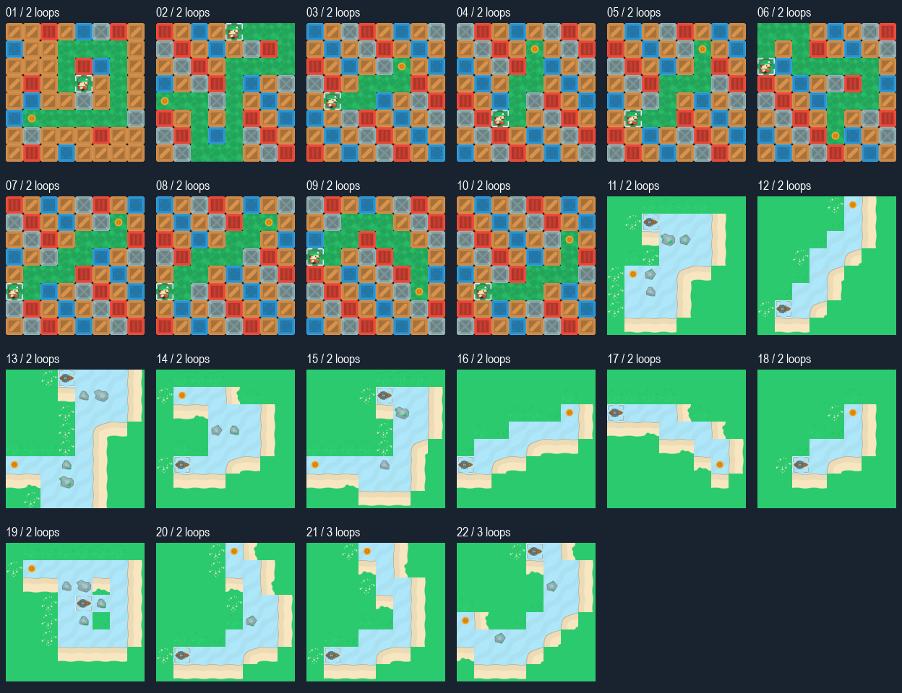

# Карты на вложенные циклы

22 карты: 1–20 используют два уровня вложенности, 21–22 — три.
В каждом примере используются только движение, повороты и `for ... in range(...)`.

Запуск из корня репозитория после установки пакета:

```bash
python demo/codomir/nested_loop/map3.py
```

Примеры показывают готовые решения и оставляют окно открытым до закрытия.
Для самостоятельной работы загрузите нужную карту и напишите команды между
`set_map(...)` и `wait_quit()`:

```python
from codomir import player, wait_quit, set_map, maps

set_map(maps.nested_loops.map3)

# Здесь будет ваша программа.

wait_quit()
```

Рекомендуемый порядок уроков:

| Этап | Карты | Учебная цель |
|---|---|---|
| Первые вложенные циклы | 3, 4, 5 | Найти повтор внутри повторяющейся ступени. |
| Составной повтор | 6, 7, 2, 8, 9, 10 | Повторять участки с поворотами и переходами. |
| Самостоятельный выбор рисунка | 11, 12, 13, 14, 15 | Отделять внутренний рисунок от соединения участков. |
| Зависимые границы | 16, 18, 1, 17, 19 | Использовать `range(i)` и убывающий счётчик. |
| Итоговая задача | 20 | Сочетать постоянные и зависимые повторы. |
| Дополнительные задачи | 21, 22 | Различать три уровня: участок, рисунок, малый повтор. |

Герой начинает смотреть вправо. Все карты помещаются в окно 512×512.
В наборе сохранены номера старых примеров; поэтому сложная спираль № 1
идёт ближе к концу курса. Змейка № 2 переработана под поле 8×8.

Для № 21 счётчик `i` считает лестничные марши, `j` — ступени,
`k` — шаги по площадке. Для № 22: `i` — большие участки, `j` — зигзаги,
`k` — малые ступени. Начните с выделения этих частей на карте.


