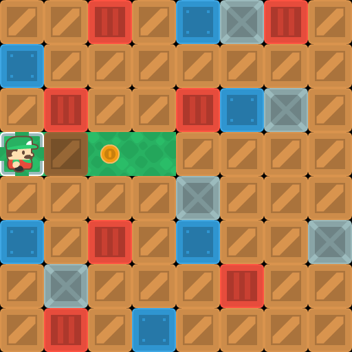
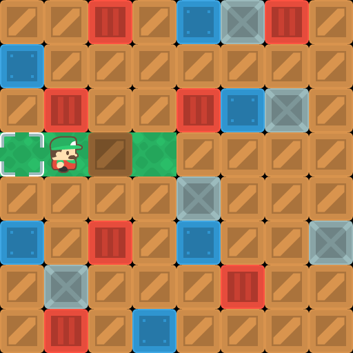
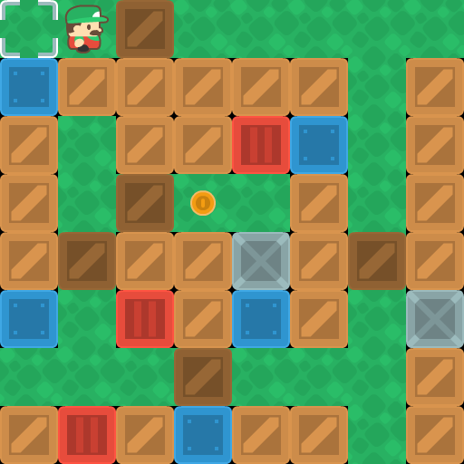
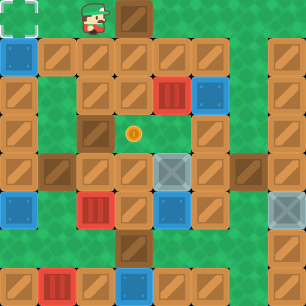
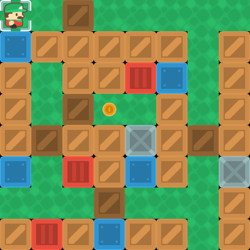

# Conditions series verification

Verified on 2026-11-09 with Windows, Python 3.11.9, pygame-ce 2.5.8,
SDL 2.32.10 and pytest 9.2.0. The scope is the ten conditions maps and
their accompanying [lesson](conditions.md).

## Runtime checks

Each of the ten public scripts runs through `runpy.run_path` in its own
subprocess with SDL dummy video/audio. Only the frame clock, long end animations
and `wait_quit` are disabled; movement, sprite updates and drawing remain active.
Every script wins once, then its teaching body wins again on the same scene
after `reset`, without `set_map` hiding reset failures. All ten linear controls
and the seven for-only controls also win on the real engine.

The manifest acceptance tests check all 33 layouts (10 main layouts and 23
variants). They compare semantic TMX geometry with the manifest, validate the
teaching AST, verify the shortest linear command count with BFS, and match
real-engine action traces against the independent model. Commands and sensor
checks after Win are rejected by the scenario wrapper.

Maps 1–3 prohibit loops and cover both outcomes across their variants, without
requiring shorter code. Maps 4–6 prohibit nested loops; maps 7–10 allow them.
For each main layout of maps 4–10, a loop takes both branches in different
iterations of the same invocation. Traces retain the loop source line,
iteration index, sensor result and chosen action in the pytest temporary
directory as `test_conditions_map_acceptanceN/trace-M.json`.

New regression checks also cover loss and reset on every conditions map,
completion callbacks firing once per run, repeated plays, box sprite uniqueness,
and transitions from conditions map9 to `linear`, `loop` and `nested_loops`
and back. These transitions run twice per family. Old box sprites lose their
groups, the player leaves the old scene, and no callback fires during reset
or map replacement.

## Solution lengths

Counts include physical nonempty teaching lines, including `for`, `if` and
`else`; imports, comments, `set_map` and `wait_quit` are excluded. A linear
solution has no loops or conditions. The for-only controls solve the main
layout; their optimality is not claimed.

| Map | Shortest linear | Conditional | For-only control | Linear minus conditional |
| --- | ---: | ---: | ---: | ---: |
| 1 | 2 | 8 | — | -6 |
| 2 | 3 | 12 | — | -9 |
| 3 | 5 | 17 | — | -12 |
| 4 | 13 | 11 | 8 | 2 |
| 5 | 18 | 17 | 13 | 1 |
| 6 | 19 | 17 | 13 | 2 |
| 7 | 19 | 12 | 13 | 7 |
| 8 | 23 | 18 | 16 | 5 |
| 9 | 26 | 24 | 20 | 2 |
| 10 | 26 | 24 | 19 | 2 |

Conditions are intentionally longer on introductory maps 1–3. The saving on
maps 4–10 is relative to linear code, not to every possible program without
`if`. The unchanged conditional program also solves the box variants; the
linear and for-only controls are tied to the main layout.

## Commands and results

Run from the repository root in PowerShell:

```powershell
$env:SDL_VIDEODRIVER = 'dummy'
$env:SDL_AUDIODRIVER = 'dummy'
$env:PYTHONDONTWRITEBYTECODE = '1'
New-Item -ItemType Directory -Force artifacts/conditions | Out-Null
.venv/Scripts/python.exe -m pytest tests/test_codomir_conditions.py -k 'public_demo_replay or switch_to_legacy or push_frames' -p no:cacheprovider --basetemp=artifacts/conditions/focused --tb=short
.venv/Scripts/python.exe -m pytest -p no:cacheprovider --basetemp=artifacts/conditions/full --tb=short
```

The focused run passed **15 tests**. The full suite passed **272 tests in
79.37 seconds**, including all ten map acceptance scenarios and existing
linear/loop/nested-loop regressions.

The lesson was also checked against the manifest and demos: ten schemas,
31 syntactically valid Python blocks, 27 complete teacher programs and 23
variant simulations. All seven lesson iteration tables match the corresponding
real-engine traces from the full run. Python comments in the lesson are English.

### Wheel installation

```powershell
$env:PIP_CERT = $env:SSL_CERT_FILE
.venv/Scripts/python.exe -m pip wheel . --no-deps --wheel-dir artifacts/conditions/wheel
.venv/Scripts/python.exe -m pip --disable-pip-version-check install --no-deps --no-compile --target artifacts/conditions/installed artifacts/conditions/wheel/pygamejr-0.0.27-py3-none-any.whl
foreach ($mapNumber in 1..10) {
    .venv/Scripts/python.exe tests/codomir_packaging_check.py artifacts/conditions/installed $mapNumber
    if ($LASTEXITCODE -ne 0) { exit $LASTEXITCODE }
}
```

The wheel built successfully and all **10 installed-package scenarios passed**
in separate processes. The checker asserts that both Python packages and each
public TMX path resolve inside the install target, so the editable checkout
cannot silently supply missing files. Each repository demo then wins using the
installed modules, TMX, external tileset and images; reset restores its boxes.
The demos themselves remain repository examples, outside the runtime wheel.
Use a fresh target directory when repeating the installation check.

Built artifact: `pygamejr-0.0.27-py3-none-any.whl`, SHA-256
`8db1be581764cf7c9f47affd956892304a9a361b42db72793cdcdeea431fc987`.

## Visual evidence

All saved surfaces are 512×512. Pixel comparisons check that the vacated cell
matches the clean background, the destination contains one correctly aligned
box, and reset exactly restores the initial frame. The last animation frame
must match a fresh draw of the resulting scene. Box group membership and counts
also rule out duplicate dynamic sprites.

| Map | Immediately before pushing | After one push | After reset |
| --- | --- | --- | --- |
| 1 |  |  |  |
| 9 |  |  |  |

On map1 the first push temporarily covers the finish with the box; the hero
has not won yet. On map9 the hero first steps toward the first box before the
before-push frame, so reset returns one cell earlier than that frame. Its
unoccupied finish is compared with a clean render without movable sprites.
